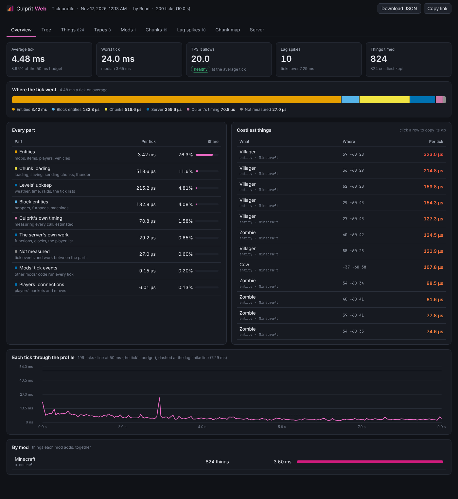
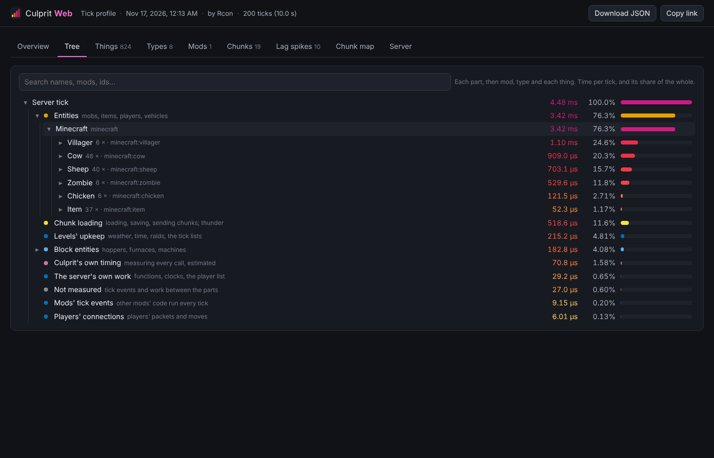
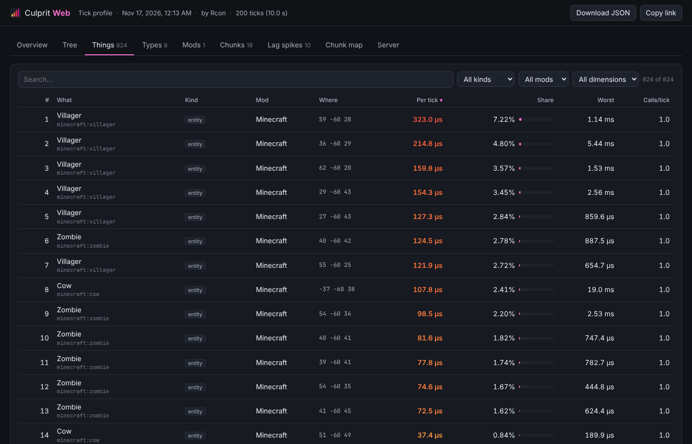
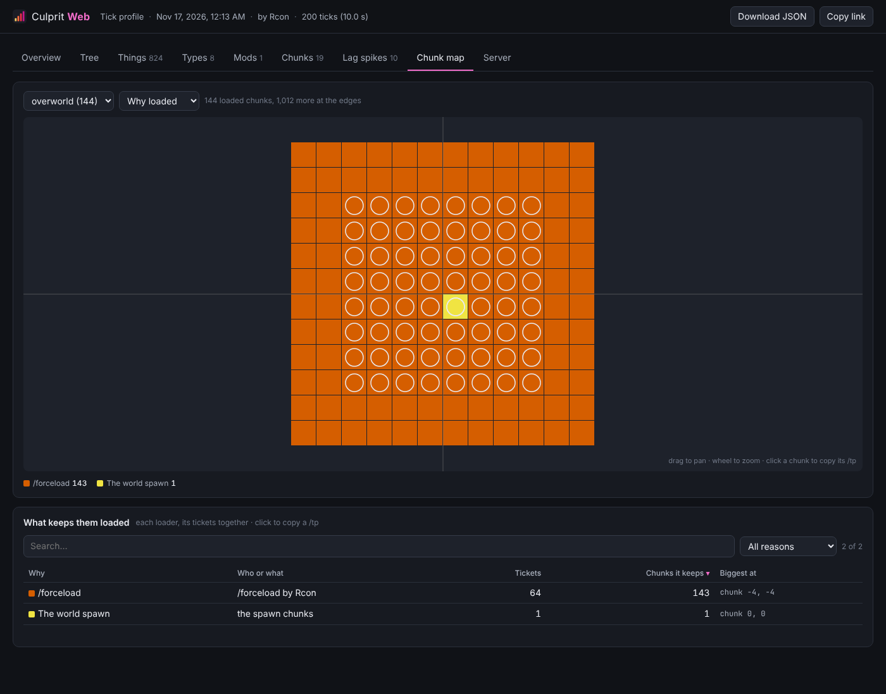
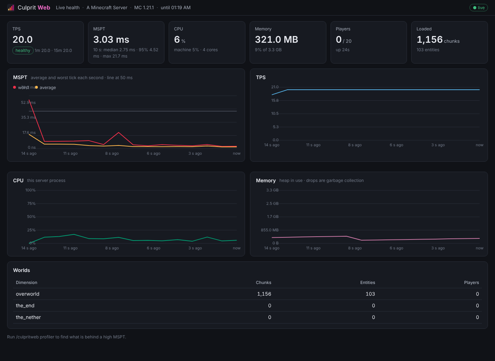

# Culprit Web

A web viewer for [Culprit](https://github.com/Lawman-afk/CulpritMCMod). Run a command, get a link, open it in a browser and see what lags your server. Works like spark's viewer, but served by the Minecraft server itself: nothing is uploaded anywhere.

This branch is for Minecraft 1.21.1 (NeoForge 21.1.266+). Needs Culprit 0.1.0+ on the server.

## Commands

All need permission level 2 (configurable). `/cweb` is a short alias.

| Command | What it does |
|---|---|
| `/culpritweb profiler [seconds]` | Runs a Culprit tick scan (default 30 s), then posts a link |
| `/culpritweb profiler stop` | Ends the scan early; the link follows |
| `/culpritweb last` | Links the last finished Culprit scan, however it was started |
| `/culpritweb chunks` | Links a census of every loaded chunk and what keeps it loaded |
| `/culpritweb health` | Links a live page: TPS, MSPT, CPU, memory, worlds (1 s refresh) |
| `/culpritweb list` | The last ten report links |

Scans started some other way (F8, `/culprit scan`) get a link sent to operators too (`autoLink`).

## The viewer

- **Overview**: average and worst tick, TPS, lag spikes, the tick split into parts, the costliest things, each tick through the profile.
- **Tree**: part, then mod, type and each thing, with time per tick and share, searchable.
- **Things / Types / Mods / Chunks**: sortable, searchable tables with kind, mod and dimension filters. Click a row to copy a `/tp` there.
- **Lag spikes**: the same lists over the slow ticks only.
- **Chunk map**: every loaded chunk coloured by why it is loaded, its cost, entities, block entities or activity, with the loaders behind them.
- **Server**: versions, JVM, mods, and the server's health when the report was made.
- Drop a JSON report saved by Culprit (`culprit/reports/*.json`) on the home page to view it offline.

## Examples

A 10 second profile of a test server with villagers, zombies, cows, a field of hoppers and 64 force-loaded chunks:

```
> /culpritweb profiler 10
Profiling the server for 10 s. /culpritweb profiler stop ends it early.
Profile done: http://localhost:8765/r/S3GzcaTeoU
> /culpritweb health
Live health (60 min): http://localhost:8765/live/DR6oUvTFqQ
```

**Overview**: average and worst tick, the tick in parts, each tick through the profile.



**Tree**: part, mod, type, each thing.



**Things**: sortable and filterable; click a row to copy a /tp.



**Chunk map**: why each chunk is loaded and who keeps it loaded.



**Live health**: TPS, MSPT, CPU and memory, refreshed every second.



More: [lag spikes](docs/screenshots/lag-spikes.png), [server info](docs/screenshots/server.png), [phone](docs/screenshots/mobile.png).

## Setup

`config/culpritweb-common.toml`:

- `port` (8765) and `bind` (0.0.0.0). Open the port in your host's firewall to share links.
- `publicUrl`: how players reach the viewer, e.g. `https://lag.example.com`. Empty uses `server-ip` (else localhost) and the port.
- `permissionLevel`, `defaultSeconds`, `autoLink`, `withChunks`, `keepReports` (100), `liveMinutes` (60).

Reports are kept as gzipped JSON in `culpritweb/reports/`. A link's random id is its only key, as with spark: anyone with the link can view that report.

## Building

JDK 21, then `./gradlew build`. Culprit's jar (MIT, built from its `1.21.1` branch) is in `libs/`.

## Licence

MIT.
